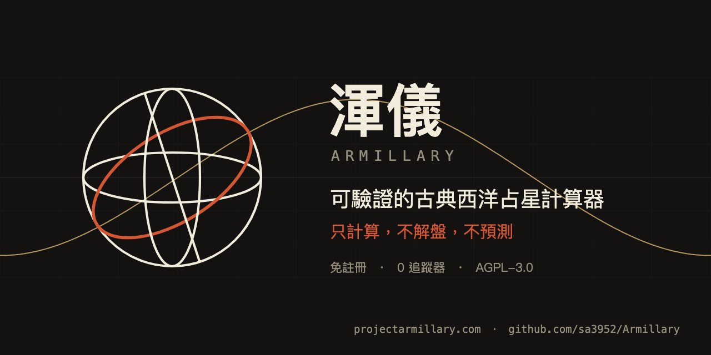
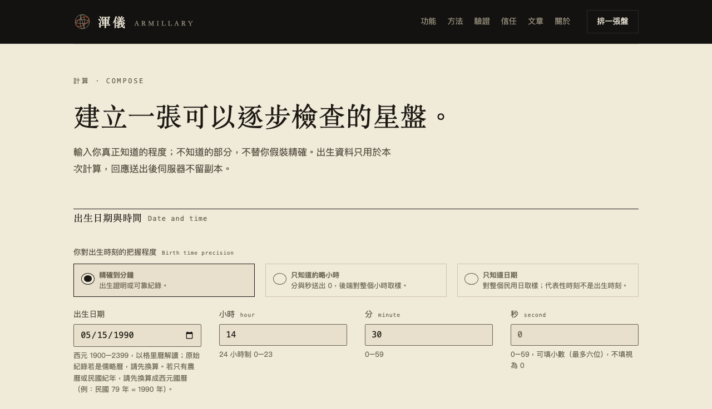
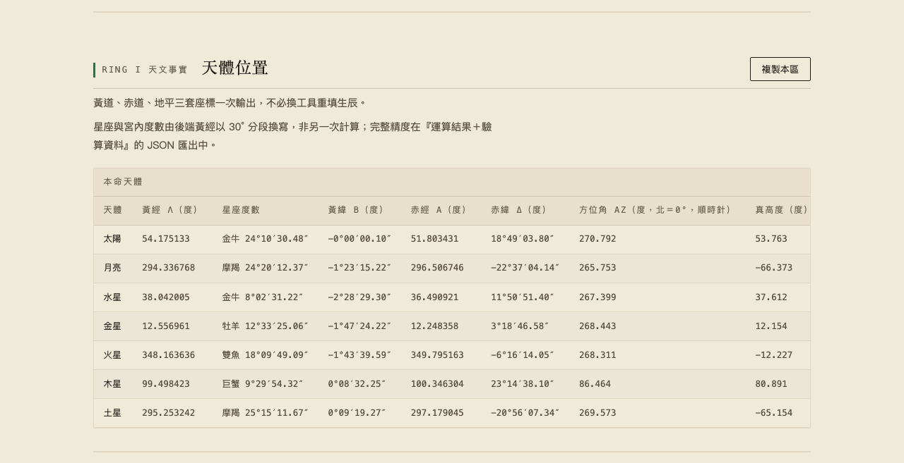
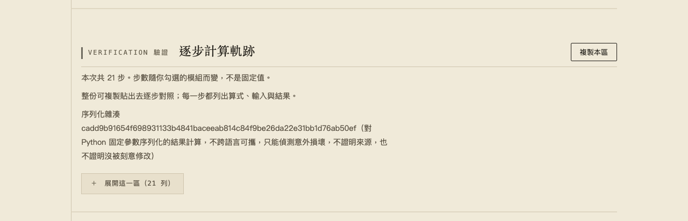

<p align="center">
  <a href="https://projectarmillary.com/zh-TW/"></a>
</p>

<h1 align="center">渾儀 Armillary</h1>

<p align="center">
  <strong>可驗證的古典西洋占星計算器</strong>　·　<strong>A verifiable classical Western astrology calculator</strong><br>
  只計算，不解盤，不預測。　Calculation only: no interpretation, no prediction.
</p>

<p align="center">
  <a href="https://projectarmillary.com/zh-TW/calculate"><strong>排一張盤 →</strong></a> ·
  <a href="https://projectarmillary.com/zh-TW/features">功能</a> ·
  <a href="https://projectarmillary.com/zh-TW/methods">方法與出處</a> ·
  <a href="https://projectarmillary.com/zh-TW/validation">驗證</a> ·
  <a href="https://projectarmillary.com/zh-TW/blog">文章</a> ·
  <a href="https://projectarmillary.com/zh-TW/security">安全</a> ·
  <a href="#english">English</a>
</p>

<p align="center"><sub>AGPL-3.0 · 繁體中文 · Swiss Ephemeris · 免註冊 · 沒有帳號與星盤資料庫 · Public Alpha</sub></p>

---

## 渾儀是什麼

渾儀 Armillary 是一套以繁體中文為主、可檢查且可重現的古典西洋占星計算工具。輸入出生日期、時間與地點，它以 Swiss Ephemeris 算出星盤，並把這張盤用了哪一套座標、哪一種時間換算、哪一條方法規則與出處，連同數字一起交給你。網站目前免費、不需註冊：<https://projectarmillary.com/zh-TW/>。這個 repository 是網站的對應原始碼（AGPL-3.0）。

| 它做的事 | 它不做的事 |
|---|---|
| 天體位置以黃道、赤道、地平三套座標並列 | 不解盤：不寫性格、運勢或吉凶文字 |
| 宮位、軸點、相位、本質尊貴、日夜盤、阿拉伯點等古典方法；規則具名，出處逐條列在〈方法〉頁 | 不預測：行運、推運、太陽回歸盤、合盤目前一項都沒有 |
| 出生時刻不確定時對整個小時取樣，標出哪些判定在取樣之間翻面 | 不替你挑一張預設的界表，也不把不同類別的尊貴折成一個分數 |
| 每次計算都能取得逐步計算軌跡、版本號與計算收據，可下載離線核對 | 不保管出生資料：沒有帳號，也沒有星盤歷史資料庫 |

## 畫面

以下畫面來自本機伺服器與計算頁內建的合成範例（1990-05-15 14:30，臺南），不是任何真實人物的出生資料。

<p align="center">
  
</p>
<p align="center"><sub>計算頁：先說你對出生時刻有多確定（精確到分鐘、約略小時、只知道日期）。</sub></p>

<p align="center">
  
</p>
<p align="center"><sub>天體位置：黃道、赤道、地平三套座標一次輸出。</sub></p>

<p align="center">
  
</p>
<p align="center"><sub>逐步計算軌跡：展開後逐列列出算式、輸入與結果；序列化雜湊只能偵測意外損壞，不證明來源，也不證明沒被刻意修改。</sub></p>

## 為什麼說「可驗證」

- **每一步都攤開。** 民用時刻 → 儒略日 → 地方恆星時 → 黃道座標 → 十二宮。展開「技術細節與驗算資料」，可以看到每一步呼叫的函式、參數、旗標與回傳值，拿同一個星曆函式庫照著重跑。
- **方法有出處。** 界表、三分性、宮位制、容許度等規則具名到作品與章節、行號或頁碼；不確定的出處照實標成不確定。逐條說明見〈[方法](https://projectarmillary.com/zh-TW/methods)〉，機器可讀的清單是
  [`method-sources.json`](frontend/zh-TW/method-sources.json)。產品能計算某項結果，不代表所有歷史占星方法都已定論或被正式採用；方法的狀態保留在完整的machine-readable result（`projection=detailed`，即驗算匯出）中。
- **對過外部基準，也寫出沒對過的地方。** 主要位置結果曾與另一條以 JPL DE442、Astropy 與 ERFA 組成的參考管線逐小時比較；月相事件與臺北的日月升降另與 USNO 資料交叉核對。比較範圍、門檻與沒有涵蓋的地方在〈[驗證](https://projectarmillary.com/zh-TW/validation)〉。這是具名範圍的驗證，不是全系統認證。
- **版本寫在結果裡。** 每次計算回報引擎、星曆與時區資料庫的版本；你這一次用的公開原始碼版本，寫在計算收據上。
- **收據的界線。** 計算收據是逐步軌跡的 SHA-256：只能偵測意外損壞，不證明來源，也不證明沒被刻意修改。

## 隱私：出生資料只是計算的輸入

- **沒有可以存出生資料的地方。** 沒有帳號資料庫、沒有星盤資料庫；application 沒有 user-data persistence volume。
- **出生資料不進 log。** Application 自己的事件採封閉 schema，不含星盤輸入、回應、IP、header 或 exception
  文字；NGINX 關閉 access log，也不把 client IP headers 轉送給 application。
- **沒有追蹤器。** 計算頁載入的每一個檔案都來自本站：沒有外部字型、CDN 或分析腳本；地名搜尋讀內建的離線目錄。唯一的可用性通知是外部 uptime monitor 對公開網站的請求。
- **我們不宣稱的。** 沒有主動寫入不等於安全抹除；本專案也沒有第三方安全認證或專業滲透測試。

完整範圍見 [privacy architecture](docs/PRIVACY_ARCHITECTURE.md)、[threat model](docs/PRIVACY_THREAT_MODEL.md)
與 [known limitations](docs/KNOWN_LIMITATIONS.md)。

## 匯出與複製

你可以把單一區段複製成以tab分隔的文字，或下載JSON、CSV、Markdown與純文字；平常只帶星盤資料，需要驗算時再加入
receipts與trace。每一種格式都來自同一份normalized result，不從畫面上的DOM反向拼湊。

## 驗證這份原始碼

每次 release 都是一份封閉的 Corresponding Source snapshot，而不是 private engineering history 的鏡像。
`PUBLICATION_FILES.json` 列出公開檔案與 hash，`SOURCE_EXPORT.json` 綁定 source export，third-party source
與 notices 也隨 release 提供。需要 Python 3.14 與 Node.js（前端測試只用 Node.js 內建的 `node --test`，不需 npm install）。

```bash
python3 -m venv .venv
source .venv/bin/activate
python -m scripts.tools.install_dev_dependencies
python scripts/verify_delivery.py
```

`verify_delivery.py` 驗 closed publication tree、privacy-sensitive dependency boundary、Python source、published
tests、frontend tests 與 source postflight。Image、host、TLS 與 live browser 需要自己的 exact artifact，不從
source test 推定。建置映像與 release 結構見 [docs/REPRODUCIBLE_BUILD.md](docs/REPRODUCIBLE_BUILD.md)。

在本機啟動（只綁 127.0.0.1；`--no-access-log` 不可省，uvicorn 預設會把每個請求的路徑與 query 寫進 access log）：

```bash
python -m uvicorn app.main:create_app --factory --app-dir backend --host 127.0.0.1 --port 8000 --no-access-log
```

然後開 <http://127.0.0.1:8000/zh-TW/calculate>。

## 專案狀態

目前是公開測試（Public Alpha）：任何人都可以直接使用，不需邀請、帳號或 email，目前仍不收費；每一個 live 版本的原始碼都保持公開。現階段刻意只做幾件事：計算正確性與明確邊界、以架構落實隱私與資安、讓結果易懂但不刪掉可驗算依據、真正可用的複製與匯出流程；加入解盤、預測或大量方法之前，先取得真實回饋。

本專案由 Sebastian 獨立開發與維護。只要問題可以重現、scope 綁定目前 public release，都歡迎提出 issue；程式碼貢獻依
[CONTRIBUTING.md](CONTRIBUTING.md)，目前不接受未經邀請的程式碼。好的報告包含 exact release、不涉及他人隱私的最小輸入（請用合成資料，不要貼真實生辰）、實際結果與預期結果；方法提案請指明傳統與來源。另見
[CONTRIBUTING.md](CONTRIBUTING.md) 與 [SUPPORT.md](SUPPORT.md)。

潛在漏洞請勿開 public issue：依 [SECURITY.md](SECURITY.md) 使用 GitHub private vulnerability reporting；網站的
[security.txt](https://projectarmillary.com/.well-known/security.txt) 列出同一條管道。

## 授權與引用

Armillary 採 [GNU Affero General Public License v3.0 only](LICENSE)。若修改後的版本透過網路與使用者互動，必須向使用者提供 Corresponding Source。Swiss Ephemeris、pyswisseph、資料檔與 build dependencies 保留各自的 license 與
notice，詳見 [THIRD_PARTY_NOTICES.md](THIRD_PARTY_NOTICES.md)。

學術、歷史或技術文章請引用 exact public commit，使被引用的計算邊界仍可辨識；GitHub 側欄的「Cite this repository」讀取 [CITATION.cff](CITATION.cff)。

---

## English

**Armillary (渾儀)** is an open-source, Traditional-Chinese-first calculator for classical Western astrology. It
computes a chart with Swiss Ephemeris and hands you, alongside every number, the coordinate frame, the time
conversion, and the named method and source that produced it. The hosted service is free for now and needs no
account: <https://projectarmillary.com/zh-TW/>. This repository is its Corresponding Source under AGPL-3.0.

**What it does.** Ecliptic, equatorial and horizontal coordinates side by side; houses and angles; aspects,
essential dignities, sect and lots, each rule named and its sources listed on the methods page; birth-time sensitivity that samples a whole
hour when the time is uncertain; a step-by-step calculation trace with the engine, ephemeris and time-zone
database versions.

**What it does not do.** No interpretation and no prediction: there are no transits, progressions, solar returns
or synastry. It does not pick a default bounds table for you, and it does not fold different dignities into one
score.

**How it can be checked.** The main positions were compared hour by hour against a separate reference pipeline
built on JPL DE442, Astropy and ERFA; lunar phases and Taipei rise and set times were cross-checked against USNO
data. The scope, thresholds and what was not covered are on the
[validation page](https://projectarmillary.com/zh-TW/validation); it is a named-scope comparison, not a
certification. The trace receipt is an unkeyed SHA-256 over the trace: it detects accidental damage only.
A supported calculation does not imply that every historical astrological method is settled or adopted;
offered methods are named and their status is kept in the full machine-readable result (`projection=detailed`,
the verification export).

### Your birth data is not the product

The service has no account, chart database or application user-data volume. Request and response bodies are
excluded from application logs, NGINX access logging is disabled, and client IP headers are not forwarded to the
application. The application's own events use a closed schema with no chart input, response, IP address, header or
exception text; the only availability notification is an external uptime monitor that requests the public site.
See the [privacy architecture](docs/PRIVACY_ARCHITECTURE.md), [threat model](docs/PRIVACY_THREAT_MODEL.md) and
[known limitations](docs/KNOWN_LIMITATIONS.md).

### Take the result with you

Copy a focused section as tab-separated text, or download the chart as JSON, CSV, Markdown, or plain text. Every
format is generated from the same normalized result rather than reconstructed from the rendered page.

### Run and verify

The commands are in the section [驗證這份原始碼](#驗證這份原始碼) above: create a virtual environment, install the
pinned dependencies, run `python scripts/verify_delivery.py`, and start a local server with the `uvicorn` line
shown there. Building the image is described in [docs/REPRODUCIBLE_BUILD.md](docs/REPRODUCIBLE_BUILD.md).

### Status and contributing

Armillary is in Public Alpha and is built and maintained independently by Sebastian. Reproducible issues scoped to
the current public release are welcome; code contributions follow [CONTRIBUTING.md](CONTRIBUTING.md), which does
not currently accept unsolicited code. Never put real birth data in an issue. Report a potential vulnerability
privately as described in [SECURITY.md](SECURITY.md).
